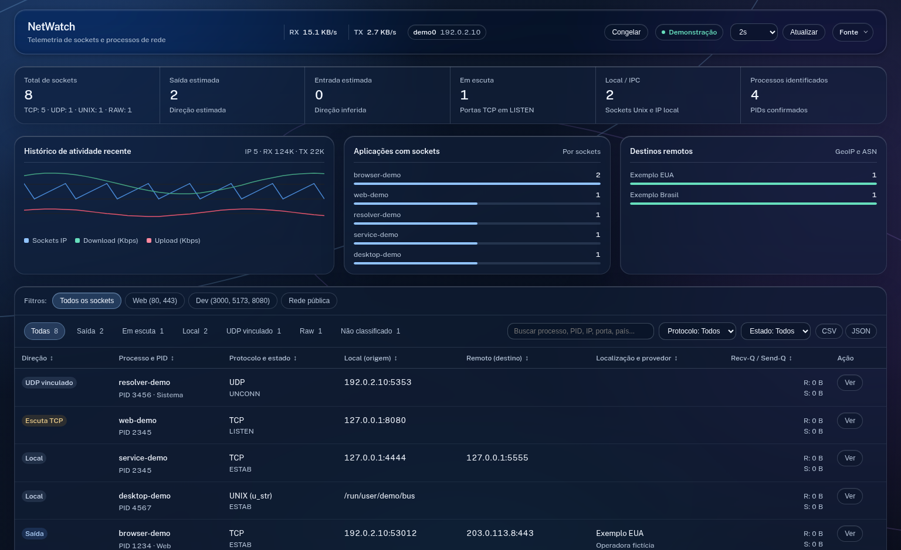

# NetWatch

**Monitore a atividade de rede do seu computador Linux em tempo real, diretamente no navegador.**

O NetWatch é um painel local para investigar **quais processos usam a rede, com quais endereços e portas se comunicam e quais sockets estão abertos**. Ele reúne taxas de transferência, histórico recente e uma tabela pesquisável em uma única interface.

Foi criado para quem precisa **entender a atividade de rede de uma máquina Linux**, sem depender de serviços de monitoramento hospedados na internet.



> **Imagem de demonstração:** os processos, endereços IP e números da captura são fictícios. A versão no GitHub Pages também começa nesse modo; nenhuma informação real da máquina é coletada apenas por abrir a página.

## O que você consegue fazer

- **Acompanhar a rede:** ver taxas de recebimento (RX) e envio (TX), interfaces disponíveis e um histórico de atividade dos últimos 60 segundos.
- **Investigar sockets e processos:** listar TCP, UDP, raw e Unix; consultar PID, estado, endereço local e destino remoto quando essas informações estiverem disponíveis.
- **Encontrar conexões específicas:** pesquisar por processo, PID, IP ou porta; filtrar por protocolo, estado, direção e categorias presentes na máquina.
- **Inspecionar detalhes:** abrir um painel com informações do socket e, quando disponível e habilitado, DNS reverso e geolocalização.
- **Exportar e analisar:** salvar resultados em CSV ou JSON, ordenar a tabela e congelar a visualização para inspeção.
- **Gerenciar processos localmente:** solicitar SIGTERM/SIGKILL com verificações de autorização e identidade do PID, **somente na interface local**.

A interface é **adaptativa**: filtros e painéis opcionais sem dados não são exibidos; a coleta distingue dados vazios de fontes indisponíveis.

### O que o NetWatch não faz

O NetWatch **não captura nem lê o conteúdo dos pacotes**, não é um firewall e não é um IDS/IPS. Ele inventaria sockets e metadados observáveis pelo sistema; algumas direções de conexão são **inferências**, não fatos capturados no tráfego. A visibilidade depende das permissões do usuário, dos namespaces Linux e das ferramentas disponíveis.

## Experimente do seu jeito

| Modo | O que aparece | Precisa instalar o coletor? |
| --- | --- | --- |
| **Prévia no GitHub Pages** | Dashboard interativo com **dados fictícios** | Não |
| **NetWatch local** | Sockets e métricas reais do computador Linux, com gerenciamento local protegido | Sim |
| **GitHub Pages conectado** | Dados reais do coletor da própria máquina, em modo **somente leitura** | Sim |

O GitHub Pages hospeda apenas a interface HTML/CSS/JavaScript. **O GitHub não executa Python, não lê a rede do visitante e não recebe automaticamente os dados da máquina.**

### 1. Executar o NetWatch localmente

**Requisitos:** Linux com `/proc`, Python 3, `ss` (iproute2), `lsof` e navegador moderno. A versão validada no desenvolvimento usa Python **3.14.9**. Node.js é necessário apenas para testes e desenvolvimento, não para executar o monitor.

Após clonar o repositório:

```bash
cd netwatch
bash ./start.sh
```

Abra **http://127.0.0.1:9876** no próprio computador. O coletor escuta somente em `127.0.0.1`, não na rede local externa.

Para conferir o serviço ou encerrá-lo:

```bash
python3 -B scripts/service_ctl.py status
bash ./stop.sh
```

Instalação de dependências por distribuição, permissões e diagnóstico: **[Guia de instalação](docs/INSTALLATION.md)**.

### 2. Abrir a prévia pelo GitHub Pages

Depois que o mantenedor publicar o site, a prévia estará em um endereço como:

```text
https://theanonx.github.io/netwatch/
```

Esse endereço é **ilustrativo até a publicação**. Você pode explorar os gráficos, filtros e o inspetor sem instalar nada: todos os dados são simulados e identificados como tal.

### 3. Conectar a página à sua própria máquina

Para trocar os dados fictícios por dados reais, inicie o coletor Linux autorizando **a origem HTTPS exata** do GitHub Pages:

```bash
bash ./stop.sh
NETWATCH_PAGES_ORIGIN=https://theanonx.github.io bash ./start.sh
cat .netwatch-pages-token
```

No site, clique em **Fonte → Conectar meu computador**, cole o código local e aceite a permissão de rede local do navegador, caso apareça. O botão **Fonte** abre um menu discreto que fecha por novo clique, clique externo ou **Esc**.

- A conexão utiliza o loopback `127.0.0.1` **na máquina do visitante**, com autenticação por token e origem autorizada.
- O pareamento é **somente leitura**: o site não consegue usar a API de encerramento de processos.
- Linhas de comando, caminhos de executáveis, usuários e hostnames são omitidos na resposta destinada ao site público. **IPs, PIDs e nomes de processos ainda são dados sensíveis**.
- O código de pareamento é renovado ao reiniciar o coletor. **Não o publique em issues, capturas de tela ou commits.**

Veja as instruções completas, limitações de navegadores e como desconectar em **[Instalação e pareamento](docs/INSTALLATION.md)**.

## Privacidade e segurança

O NetWatch é **local por padrão**. A API fica restrita ao loopback e a integração com GitHub Pages precisa ser ativada explicitamente. O GeoIP externo é opcional e fica desativado por padrão; ao ativá-lo, IPs públicos poderão ser consultados no serviço `ipwho.is`.

O coletor não requer execução como root. O encerramento de processos na interface local exige verificação de origem, token CSRF e identidade do processo. **Não exponha a porta 9876 na internet.**

Consulte **[SECURITY.md](SECURITY.md)** para o modelo de ameaças, limitações e recomendações de operação.

## Como funciona

```text
Linux (ss, lsof, /proc, /proc/net/dev)
                 |
                 v
        Coletor Python local
         127.0.0.1:9876
                 |
         +-------+--------+
         |                |
         v                v
   Dashboard local   GitHub Pages HTTPS
   (controle local)  (pareamento opcional,
                      somente leitura)

Sem coletor conectado ao Pages: demonstração fictícia.
```

A coleta utiliza `ss` para sockets TCP/UDP, raw e Unix, com informações adicionais de `/proc` e `lsof` quando acessíveis. As taxas RX/TX são obtidas de `/proc/net/dev`; um worker independente dos visitantes atualiza o histórico. Se alguma fonte falhar, a API informa a condição em vez de apresentar ausência de dados como se fosse zero.

A interface usa HTML, CSS e JavaScript nativos, com efeitos ópticos leves baseados no projeto MIT [liquid-glass-web](https://github.com/Meapri/liquid-glass-web), incluído em `web/vendor/liquid-glass/` junto com sua licença.

## Documentação

| Guia | Conteúdo |
| --- | --- |
| [Instalação](docs/INSTALLATION.md) | Dependências, execução local, pareamento e GeoIP opcional |
| [Arquitetura](docs/ARCHITECTURE.md) | Coleta, API, segurança e arquitetura dos modos |
| [Publicação](docs/RELEASE.md) | GitHub Pages, workflow, branch pública e rollback |
| [Diagnóstico](docs/TROUBLESHOOTING.md) | Problemas de execução, coleta, CORS e permissões |
| [Segurança](SECURITY.md) | Superfície de ataque, medidas e riscos residuais |
| [Contribuição](CONTRIBUTING.md) | Como desenvolver e enviar alterações |

### Desenvolvimento e testes

Para executar a suíte (Node.js é usado nos testes JavaScript):

```bash
python3 -B -m unittest discover -s tests -v
node --check web/app.js
node --check web/pages.js
node --check web/demo.js
python3 -B scripts/build_pages.py
python3 -B scripts/check_release.py
```

A prévia estática é gerada em `dist/pages/`, sem incluir código Python do coletor, caches ou tokens. **O repositório destinado ao GitHub deve ser publicado a partir da branch `public-release`**, conforme o guia de release, para preservar o histórico privado de desenvolvimento.

## Licença

Código do NetWatch sob **[MIT](LICENSE)**. As licenças e atribuições de componentes de terceiros são preservadas nos respectivos diretórios `vendor`.
